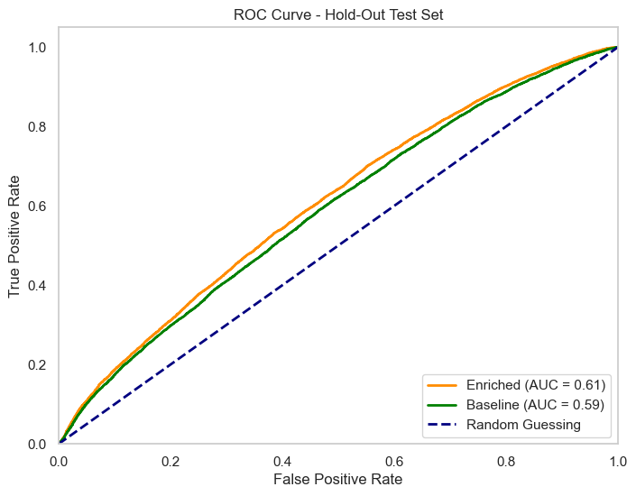

# Airbnb Demand Forecasting with Ticketmaster Signals
### A Random Forest Framework Integrating Venue Capacity and Geo-spatial Event Data

**[Read the Full Academic Paper (PDF)](./docs/D606_Task2%20-%20Capstone.pdf)*

## Problem Statement
Demand forecasting in the short-term rental market is essential for businesses seeking to optimize their pricing strategies and maximize revenue. At the same time, accurate demand forecasting helps guests make better decisions about whether to book a property immediately or delay booking due to wide availability. Traditional forecasting models usually look only at baseline property data, such as a listing's historical price, location, or day of the week. However, these internal metrics often miss sudden spikes in external demand caused by major concerts, sporting events, or festivals. This study tests whether integrating hyper-local live entertainment data from the Ticketmaster API significantly improves the forecasting accuracy of a Random Forest classifier.

## Research Question
Using a random forest classifier, to what extent does integrating hyper-local event data from the Ticketmaster API improve the predictive accuracy of Seattle Airbnb long-term demand forecasting?

## Null and Alternative Hypothesis
- Null Hypothesis- There is no statistically significant difference (p > 0.05) in predictive accuracy between the baseline control model and the event-enriched model, validated via a 5-fold cross-validation and a corrected resampled paired t-test (μ∆AUC ≤ 0). Any observed improvement is due to random chance. 

- Alternate Hypothesis- There is a statistically significant improvement (p < 0.05) in predictive accuracy when moving from the baseline control model to the event-enriched model, validated via a 5-fold cross-validation and a corrected resampled paired t-test (μ∆AUC > 0).

It is important to note that 5-fold cross-validation violates the assumption of independence in the standard paired t-test, since the samples are reused after each fold. Therefore, applying the standard t-test would increase the chance of a Type 1 error, in which a statistically significant difference is falsely identified (Kiani, 2019). Nadeau and Bengio (2003) proposed a corrected, resampled paired t-test that accounts for data dependence and variance underestimation associated with cross-fold validation.

## Data Collection
The data collection process involved obtaining open-source Airbnb listing data and Ticketmaster event data. The Airbnb listing data is easily accessible as downloadable CSV files at www.insideairbnb.com (Inside Airbnb, 2024) and contains regional archives by scraped date. The Ticketmaster event data is accessible via an API, and the documentation is available here: https://developer.ticketmaster.com/products-and-docs/apis/discovery-api/v2/ (Discovery API 2.0, 2026). Using Postman (a graphical user interface for testing APIs), I retrieved Seattle event data and saved the API response to a JSON file. Finally, I retrieved venue maximum capacities from Wikipedia (“Climate Pledge Arena," 2023; "Lumen Field," 2021; "T-Mobile Park," 2025).

One advantage of my data-gathering methodology is that it combines listing and event data from two different sources. This simulates real-world dynamics, as major events draw people from all over the world into the city where they are occurring. Technically speaking, having the listing data prepared in a CSV file and the event data in a JSON file made these simple to load and transform using the pandas library. In other words, I was not forced to scrape the data from the web tediously myself.

One disadvantage of my data-gathering methodology is the lack of historical flexibility – particularly because I could not retrieve historical event data from the Ticketmaster API. Since my Airbnb listing data was scraped on 6/15/2026 and my Ticketmaster event data was scraped on 8/1/2026, the lack of historical event data prevented me from analyzing short-term trends. I had to adapt by using a forward-looking date range of 8/1/2026 – 8/31/2026 for my analysis, which indicates a lead time of 46 – 77 days. Therefore, my model will train on and predict long-term booking demand using the date window 8/1/2026 – 8/31/2026.

I encountered two major challenges during this process. First, being bound to the last scraped date (6/15/2026) was challenging, as it only provided a snapshot of booked and un-booked listings at that time (a forward-looking 12 months from that date). Furthermore, the "lead time" in the hospitality industry is an important metric, indicating the time between a customer's purchase (booking) and the date of stay (Katz et al., 2025). According to SiteMinder's Hotel Booking Trends, the average lead time in hotel bookings is 36 days (Elphick, 2024). This implies that training our model beyond 36 days from the scraped date may not provide sufficient short-term booking accuracy. I overcame this by accepting that my model would instead focus strictly on long-term demand forecasting, which also provides business value.

The second challenge was merging the listing and event data Joining on the listing/event date appeared simple enough; however, if multiple events occur on a single date, the event features must be aggregated to maintain a 1:1 relationship with the listing date. I overcame this by aggregating the event features so that the listing date receives the appropriate weight for the events occurring that day (See methodology below).

## Methodology: Data-Preprocessing
To extract the Airbnb data, I used a web browser to download the listings.csv and calendar.csv files from Inside Airbnb's (2024) Seattle archives (scraped on 6/15/2026). To extract Seattle event data, I used Postman to call the Ticketmaster Discover API, sending a GET request with the appropriate query parameters to retrieve events for 8/1 – 8/31/2026. I saved the API response to a JSON file. Finally, I used Wikipedia to extract each event venue's maximum capacity and created a custom pandas DataFrame to store that information.

To prepare my data, I created a Jupyter Notebook file within Visual Studio Code. I set up my environment using conda, which contained a baseline environment with dependencies and libraries already installed. Within the Jupyter Notebook file, I imported libraries and dependencies, including json, pandas, NumPy, and haversine. The data preparation and transformation steps relied heavily on the pandas library, which provided the necessary tools for data pre-processing. The json library was used to load and parse the JSON file. The NumPy and haversine libraries were used to calculate the capacity-weighted distance.

Using the pandas library, basic techniques such as filtering, dropping columns, updating data types, inspecting, and joining DataFrames were used. One of the more challenging techniques used during data preparation involved computing the capacity-weighted distance (defined as the distance between the listing and one or more venues, weighted by each venue's maximum capacity). To obtain the capacity-weighted distance, I first aggregated Seattle event data by event date, creating a payload containing each venue's latitude, longitude, and maximum capacity. By aggregating the event data by date, I maintained a 1:1 relationship between each listing's calendar date and its event data. After joining the listing and event data, I now had access to each listing's latitude and longitude, as well as the event payload. I applied the Haversine formula to calculate the distance from each venue to the listing. Then I obtained the capacity-weighted distance by summing each distance multiplied by its respective proportion of total capacity. Note that the Haversine distance (2022) measures the distance between two points (specified by their latitude and longitude) on the surface of a sphere. After obtaining the capacity-weighted distance for each row, I removed unnecessary columns and saved my final DataFrame as a CSV file for later use.

## Methodology: Random Forest Classification Model
To begin training and cross-validation, I implemented the GroupShuffleSplit function from the scikit-learn library, which partitioned the dataset into training (80%) and test (20%) sets grouped by listing_id. Justification: The GroupShuffleSplit function is ideal in this case to prevent data leakage. If the data were split randomly without regard to the listing_id, the model could "cheat" during evaluation. This is because rows from the same listing would appear in both the training and testing phases, causing the model to memorize specific listing traits rather than generalizing well to new data.

After partitioning the data, I used my training set to create two distinct feature sets. The baseline feature set contained only listing variables, including price, is_weekend, neighborhood, and lead_time. The enriched feature set included the baseline features and the event features, including global_event_count, total_daily_capacity, and capacity_weighted_distance.
The neighborhood variable was intentionally left unencoded prior to the dataset partition. Justification: This approach prevents data leakage, ensuring that any subsequent encoding rules are learned exclusively from the training set. Scikit-learn's ColumnTransformer was used to transform the neighborhood column while leaving the remaining columns untouched.

The ColumnTransformer was implemented as the first step in a scikit-learn Pipeline, followed by model training with a Random Forest classifier. Justification: The Random Forest classifier was selected because this is a binary classification task (predicting one of two outcomes: booked versus un-booked). This model operates as a non-parametric ensemble method - meaning a normal Gaussian distribution is not assumed, which combines the predictions of multiple individual decision trees to improve overall accuracy and control over-fitting (Scikit-learn, n.d.).
Hyperparameter tuning/optimization was conducted via RandomizedSearchCV using 5-Fold GroupKFold cross-validation. Justification: This random search approach ensured that both the baseline and enriched feature sets were evaluated under identical search spaces and parameter ranges, granting them an equal opportunity for optimization.

Following the search, the optimal hyperparameter configurations were identified for each model. Finally, the Area Under the Receiver Operating Characteristic Curve (ROC-AUC) scores were extracted for each of the five folds to compare the cross-validation performance between the baseline and enriched models. Justification: The AUC score was selected because it evaluates the model's ability to correctly distinguish between the two classes (booked vs. un-booked) across all possible classification thresholds (Google, n.d.). Unlike standard accuracy, which only looks at a single fixed cutoff point and can be misleading even with mild class imbalances, ROC-AUC measures the balance between the true positive rate (sensitivity/recall) and the false positive rate (Google, n.d.). This provides a much more robust and comprehensive assessment of overall classification performance when comparing the baseline and enriched models.

One Advantage: An advantage of this training and validation pipeline is its high level of integrity regarding data leakage. By using scikit-learn Pipelines, GroupShuffleSplit, and GroupKFold, I ensured that information from the test sets and specific listing groups never leaked into the training process. Additionally, using RandomizedSearchCV is a highly efficient way to explore a wide range of hyperparameters without the massive computational expense of testing every single combination, allowing me to find an optimal model quickly. Using a Random Forest classification model fits perfectly with my data set since it operates as a non-parametric ensemble method - meaning a normal Gaussian distribution is not assumed, which combines the predictions of multiple individual decision trees to improve overall accuracy and control over-fitting (Scikit-learn, n.d.).

One Disadvantage: A disadvantage of this approach is the high computational complexity and processing time. Training an ensemble method like Random Forest multiple times across 5 folds while simultaneously searching over random hyperparameters requires significant computational power. Additionally, while grouping by listing_id prevents data leakage, it might restrict the model's ability to learn if a specific subset of geographic locations (neighborhoods) becomes entirely tied to a single training fold.

``` python
# Define features and target array
X_baseline = train_df.drop(columns=['listing_id', 'date', 'day_of_week', 'is_booked', 'global_event_count', 'total_daily_capacity', 'capacity_weighted_distance'])

X_enriched = train_df.drop(columns=['listing_id', 'date', 'day_of_week', 'is_booked'])
y = train_df['is_booked']
groups = train_df['listing_id']

# Build the column transformer
column_transformer = ColumnTransformer(
    transformers=[
        ('neighborhood', TargetEncoder(smoothing=10.0), ['neighborhood'])
    ],
    remainder='passthrough'
)

# Build the base pipeline
pipeline = Pipeline(
    steps=[
        ('column_transformer', column_transformer),
        ('classifier', RandomForestClassifier(
            random_state=42,                   
            n_jobs=-1,
            class_weight='balanced_subsample'
        ))
    ]
).set_output(transform='pandas')

# Initialize GroupKFold
group_kfold = GroupKFold(n_splits=5)

# Define distribution ranges for random sampling
param_distributions = {
    # Dynamically picks any integer from 5 up to 25
    'classifier__max_depth': randint(5, 26),
    # Dynamically picks any integer from 100 up to 500
    'classifier__n_estimators': randint(100, 501),

    # Hyperprams to control overfitting
    'classifier__min_samples_split': randint(2, 20),
    'classifier__min_samples_leaf': randint(1, 20),
    
    # Test different feature sub-selection strategies
    'classifier__max_features': [0.2, 0.4, 0.6, 0.8, 'sqrt', 'log2']
}

# Tuning Baseline Model via Random Search
print("Running Randomized Search on Baseline Model...")
random_search_baseline = RandomizedSearchCV(
    estimator=pipeline,
    param_distributions=param_distributions,
    n_iter=5,                  # Evaluates 5 random combinations per model
    cv=group_kfold,            # Restricts cross-validation by listing groups
    scoring='roc_auc',         # Optimizes for Area Under the ROC Curve
    n_jobs=-1,                 # Uses all CPU cores
    random_state=42,           # Makes the random choices reproducible
    verbose=1
)
random_search_baseline.fit(X_baseline, y, groups=groups)

# Tuning Enriched Model via Random Search
print("\nRunning Randomized Search on Enriched Model...")
random_search_enriched = RandomizedSearchCV(
    estimator=pipeline,
    param_distributions=param_distributions,
    n_iter=5,                  
    cv=group_kfold,            
    scoring='roc_auc',         
    n_jobs=-1,                 
    random_state=42,           
    verbose=1
)
random_search_enriched.fit(X_enriched, y, groups=groups)

# Print Best Hyperparams and Best Out-of-Fold Scores
print("\n=== OPTIMIZED RESULTS ===")
print(f"Baseline - Best Params: {random_search_baseline.best_params_}")
print(f"Baseline - Best CV ROC AUC: {random_search_baseline.best_score_:.4f}")

print(f"\nEnriched - Best Params: {random_search_enriched.best_params_}")
print(f"Enriched - Best CV ROC AUC: {random_search_enriched.best_score_:.4f}")


AUC_baseline = []
AUC_enriched = []

# Save best AUC scores for each fold
for i in range(5):
    AUC_baseline.append(random_search_baseline.cv_results_[f'split{i}_test_score'][random_search_baseline.best_index_])
    AUC_enriched.append(random_search_enriched.cv_results_[f'split{i}_test_score'][random_search_enriched.best_index_])

# Print the best AUC scores for each fold
#print(f"\nBaseline - AUC scores per fold: {AUC_baseline}")
#print(f"Enriched - AUC scores per fold: {AUC_enriched}")

# Print fold scores for a search object
def print_best_fold_scores(search_obj, name):
    best_idx = search_obj.best_index_
    print(f"\n{name} - Score per fold:")
    for i in range(5):
        score = search_obj.cv_results_[f'split{i}_test_score'][best_idx]
        print(f"  Fold {i+1}: {score:.4f}")

print_best_fold_scores(random_search_baseline, "Baseline")
print_best_fold_scores(random_search_enriched, "Enriched")
```

```
Running Randomized Search on Baseline Model...
Fitting 5 folds for each of 5 candidates, totalling 25 fits

Running Randomized Search on Enriched Model...
Fitting 5 folds for each of 5 candidates, totalling 25 fits

=== OPTIMIZED RESULTS ===
Baseline - Best Params: {'classifier__max_depth': 25, 'classifier__max_features': 0.4, 'classifier__min_samples_leaf': 19, 'classifier__min_samples_split': 12, 'classifier__n_estimators': 187}
Baseline - Best CV ROC AUC: 0.5946

Enriched - Best Params: {'classifier__max_depth': 25, 'classifier__max_features': 0.4, 'classifier__min_samples_leaf': 12, 'classifier__min_samples_split': 7, 'classifier__n_estimators': 485}
Enriched - Best CV ROC AUC: 0.6020

Baseline - Score per fold:
  Fold 1: 0.5973
  Fold 2: 0.5913
  Fold 3: 0.6024
  Fold 4: 0.5878
  Fold 5: 0.5940

Enriched - Score per fold:
  Fold 1: 0.6052
  Fold 2: 0.6003
  Fold 3: 0.6067
  Fold 4: 0.5964
  Fold 5: 0.6017
```

## Significance Testing
Implementing a corrected, resampled paired t-test (Nadeau & Bengio, 2003) to assess statistical significance involved subtracting the baseline scores from the enriched scores. Using a Python implementation (Kateryna, 2021) of this test, the t-statistic was calculated to be 6.0497 with a corresponding p-value of 0.00377. Because the p-value is less than 0.05, this confirms that the addition of event features (the enriched feature set) had a statistically significant impact on the model's predictive performance. Justification: It must be noted that 5-fold cross-validation violates the assumption of independence in the standard paired t-test because the samples are reused after each fold. Therefore, using the standard t-test would increase the chance of a Type 1 error, in which a statistically significant difference is falsely identified (Kiani, 2019). Nadeau and Bengio (2003) proposed a corrected, resampled paired t-test that accounts for data dependence and variance underestimation associated with cross-fold validation.

One Advantage: One advantage to implementing a corrected resampled paired t-test is that it accounts for sample dependence due to cross-fold validation. It also minimizes the risk of a Type 1 error. Therefore, the results are more reliable than those from a standard t-test, in which the assumption of independence among samples would be violated.

One Disadvantage: While there are few disadvantages to implementing a corrected resampled t-test, it should be noted that standard Python libraries do not have native support for this test. Therefore, it is often coded manually, which can introduce errors if not implemented correctly.

``` python
baseline_cv_aucs = np.array(AUC_baseline)
enriched_cv_aucs = np.array(AUC_enriched)

# Compute differences and basic dimensions
differences = enriched_cv_aucs - baseline_cv_aucs
n_folds = len(differences)
mean_diff = np.mean(differences)
variance_diff = np.var(differences, ddof=1)

# Approach A: Standard Paired t-test
standard_t_stat, standard_p_val = stats.ttest_rel(enriched_cv_aucs, baseline_cv_aucs)


# Approach B: Nadeau & Bengio Corrected Resampled t-Test
# https://drogaieva.medium.com/designing-machine-learning-experiment-and-interpreting-experimental-results-cbf870caf68d

# For 5-fold CV: test set = 20%, training set = 80%
ratio = 0.20 / 0.80 
corrected_variance = variance_diff * ((1 / n_folds) + ratio)
corrected_t_stat = mean_diff / np.sqrt(corrected_variance)
# Two-tailed p-value with df = n - 1
corrected_p_val = stats.t.sf(np.abs(corrected_t_stat), df=n_folds-1) * 2


# Print results
--- APPROACH A: Standard Paired t-test ---
t-statistic: 9.0746
p-value:     0.00082
Significant? True

--- APPROACH B: Corrected Resampled t-test ---
t-statistic: 6.0497
p-value:     0.00377
Significant? True
```

```
--- Corrected Resampled t-test ---
t-statistic: 6.0497
p-value:     0.00377
Significant? True
```

## Evaluation of Hold-Out Test Set
To evaluate how well the optimized models generalize to unseen data, I applied them to the hold-out test set. I calculated the Area Under the Curve (AUC) scores for both the baseline and enriched models. The baseline model achieved an AUC of approximately 0.59, while the enriched model reached 0.61. Although a 2% improvement may seem small, it represents a measurable increase in predictive power. Justification: A final evaluation on a hold-out dataset is crucial to verify that a model hasn't simply memorized the training data (overfitted) but can perform well in the real world. This step validates the entire modeling process and helps determine if further hyperparameter tuning or model selection is necessary.

One Advantage: Evaluating the hold-out test set provides a final performance metric, allowing us to analyze the model's true capabilities on unseen data.

One Disadvantage: There are few disadvantages to evaluating a hold-out test set; however, one might argue that the large amount of data (over 200,000 rows) could have allowed for a smaller hold-out test set (a larger training set). Allocating more data to the training set might have given the models the extra information they needed to boost performance.

``` python
# Prepare hold-out features and true labels
# Ensure columns match training sets exactly
X_test_baseline = test_df.drop(columns=['listing_id', 'date', 'day_of_week', 'is_booked', 'global_event_count', 'total_daily_capacity', 'capacity_weighted_distance'])
X_test_enriched = test_df.drop(columns=['listing_id', 'date', 'day_of_week', 'is_booked'])

y_test = test_df['is_booked']

# Predict probabilities for the positive class (column index 1)
# Using random_search_baseline.predict_proba calls the best estimator automatically
proba_baseline = random_search_baseline.predict_proba(X_test_baseline)[:, 1]
proba_enriched = random_search_enriched.predict_proba(X_test_enriched)[:, 1]

# Calculate Hold-Out ROC AUC Scores
auc_baseline = roc_auc_score(y_test, proba_baseline)
auc_enriched = roc_auc_score(y_test, proba_enriched)

# Print the final results
print("=== HOLD-OUT TEST RESULTS ===")
print(f"Baseline Model Hold-Out AUC: {auc_baseline:.4f}")
print(f"Enriched Model Hold-Out AUC: {auc_enriched:.4f}")
```

```
=== HOLD-OUT TEST RESULTS ===
Baseline Model Hold-Out AUC: 0.5904
Enriched Model Hold-Out AUC: 0.6069
```



## Summary and Limitations
Since the corrected resampled t-test yielded a p-value less than 0.05, the null hypothesis is rejected in favor of the alternative hypothesis. This implies that the model with event-enriched features showed a statistically significant improvement in long-term forecasting for Seattle Airbnbs. As seen on the ROC-AUC graph, the enriched model has 2% more area under the curve, meaning it is better able to distinguish between classes (booked vs. un-booked).

A limitation of my analysis is that the lead time was likely too far out, resulting in fewer bookings to reliably train the models on. While the study pivoted to address this data sparsity, the lack of booking volume far in advance may have capped the performance of both models.

Course of Action Based on Results: Given these findings, hyper-local event data should be considered when forecasting long-term demand for Seattle-based rentals. Although a 2% improvement in the AUC score may seem small, it is statistically significant compared with using only baseline data. Immediate action in the form of further optimization of the model, hyperparameters, features, and methodology is needed, since a 0.61 AUC score is only slightly better than a coin flip at predicting bookings.

## Future Study
*Closer Lead Times*: Future research should look at how the models perform at closer intervals, such as 30, 60, or 90 days out. This would help identify the exact timeline at which event data becomes most accurate and determine whether the data sparsity issue naturally resolves as the lead time shortens.

*Feature Engineering/Optimization*: Further research into engineering/optimizing event variables should be considered. Feature importance should be analyzed, and alternative features should be considered, including but not limited to holidays, weather conditions, seasonality, and a broader range of events.

## References
Climate pledge arena. (2023). In Wikipedia. https://en.wikipedia.org/wiki/Climate_Pledge_Arena

Discovery API 2.0. (2026). In The Ticketmaster Developer Portal. https://developer.ticketmaster.com/products-and-docs/apis/discovery-api/v2/

Elphick, D. (2024). Booking lead time: Guide for hotels | SiteMinder. In SiteMinder. https://www.siteminder.com/r/booking-lead-time/

Google. (n.d.). Classification: ROC and AUC. In Google for Developers. Retrieved August 14, 2026, from https://developers.google.com/machine-learning/crash-course/classification/roc-and-auc#area_under_the_curve_auc

Haversine distance — Distancia 0.0.1 documentation. (2020). In Readthedocs.io. https://distancia.readthedocs.io/en/latest/Haversine.html

Inside Airbnb. (2024). Get the data. In insideairbnb.com. https://insideairbnb.com/get-the-data/
Kateryna. (2021, May 20). Designing machine learning experiment and interpreting experimental results. Medium. https://drogaieva.medium.com/designing-machine-learning-experiment-and-interpreting-experimental-results-cbf870caf68d

Katz, H., Savage, E., & Coles, P. (2025). Lead Times in flux: Analyzing airbnb booking dynamics during global upheavals (2018–2022). Annals of Tourism Research Empirical Insights, 6(2), 100185–100185. https://doi.org/10.1016/j.annale.2025.100185

Kiani, J. (2019). Using the corrected paired student’s T-test for comparing machine learning models. In Analytics Vidhya. https://medium.com/analytics-vidhya/using-the-corrected-paired-students-t-test-for-comparing-the-performance-of-machine-learning-dc6529eaa97f

Lumen field. (2021). In Wikipedia. https://en.wikipedia.org/wiki/Lumen_Field

Nadeau, C., & Bengio, Y. (2003). Inference for the Generalization Error. Machine Learning, 52(3), 239–281. 	https://doi.org/10.1023/a:1024068626366

Rezaei, N., & Jabbari, P. (2022). Random forests in R. Elsevier eBooks, 169–179. https://doi.org/10.1016/b978-0-12-822400-7.00001-4

Scikit-Learn. (n.d.). Sklearn.Ensemble.RandomForestClassifier — Scikit-learn 0.20.3 documentation. In Scikit-learn.org. Retrieved August 12, 2026, from https://scikit-learn.org/stable/modules/generated/sklearn.ensemble.RandomForestClassifier.html

Sugavasilakshmisahithi. (2025). Winsorization: A simple and effective way to handle outliers in your data. In Medium. Data Science Collective. https://medium.com/data-science-collective/winsorization-a-simple-and-effective-way-to-handle-outliers-in-your-data-e9635c3bc049

T-mobile park. (2025). In Wikipedia. https://en.wikipedia.org/wiki/T-Mobile_Park

